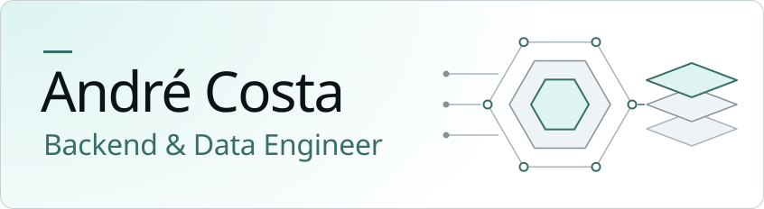
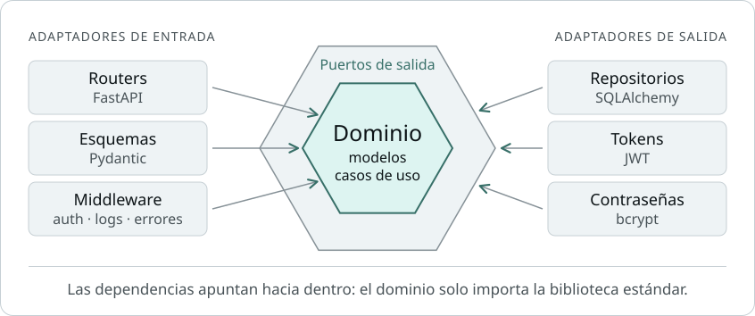
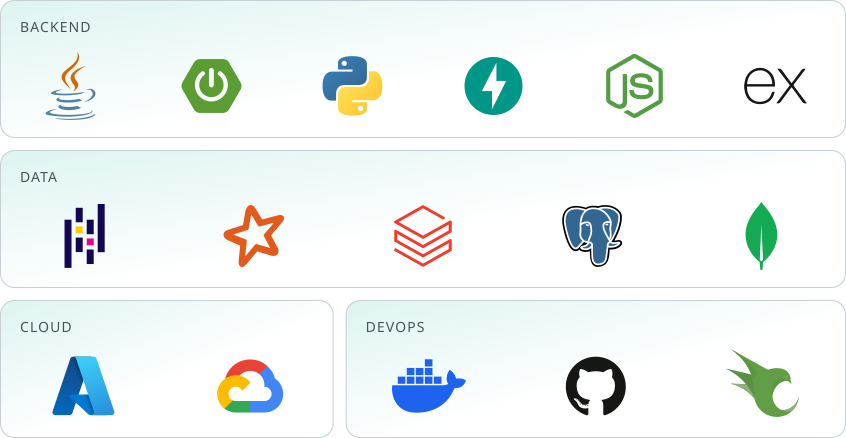

<picture>
  <source media="(prefers-color-scheme: dark) and (min-width: 1012px)" srcset="./assets/banner-wide-dark.svg">
  <source media="(prefers-color-scheme: dark)" srcset="./assets/banner-narrow-dark.svg">
  <source media="(max-width: 1011px)" srcset="./assets/banner-narrow-light.svg">
  
</picture>

Construyo APIs REST y ETLs. Desarrollo con agentes de IA: escribo la especificación, ellos implementan el código y los tests, y la última revisión es mía.

Soy miembro de [GDG Santander](https://gdg.community.dev/gdg-santander/) (Google Developer Group) desde 2025.

<!-- REVISAR Enlace al portfolio: añadirlo aquí cuando tenga dominio. -->

## Proyectos

### [react-fastapi-template](https://github.com/andrelup/react-fastapi-template)

**Proyecto personal** · Licencia MIT

Plantilla React + FastAPI para empezar un proyecto con el backend hexagonal, la autenticación y la CI ya montados.

<picture>
  <source media="(prefers-color-scheme: dark) and (min-width: 1012px)" srcset="./assets/architecture-wide-dark.svg">
  <source media="(prefers-color-scheme: dark)" srcset="./assets/architecture-narrow-dark.svg">
  <source media="(max-width: 1011px)" srcset="./assets/architecture-narrow-light.svg">
  
</picture>

- [Por qué hexagonal](https://github.com/andrelup/react-fastapi-template/blob/main/docs/adr/0004-por-que-hexagonal.md), qué cuesta y cuándo no usarla.
- [Decisiones de arquitectura (ADR)](https://github.com/andrelup/react-fastapi-template/tree/main/docs/adr), con su porqué.
- [Workflows de CI](https://github.com/andrelup/react-fastapi-template/tree/main/.github/workflows): lint, tipado estricto y tests de la parte que cambia; análisis de seguridad en cada PR.
- [Cómo quitar el catálogo de ejemplo](https://github.com/andrelup/react-fastapi-template/blob/main/docs/the-example-domain.md), incluido a propósito.

### [BookShelf](https://github.com/andrelup/bookshelf)

**Proyecto personal** · Licencia MIT

Marketplace de libros, pensado para que cada vendedor publique y venda los suyos. Backend hexagonal con FastAPI y PostgreSQL; frontend con React. Un ejemplo de react-fastapi-template aplicado en un caso concreto.

<table>
  <tr>
    <th align="left">Hecho</th>
    <td>Registro e inicio de sesión con JWT, roles de cliente y vendedor, API de libros y de listas de favoritos, <a href="https://github.com/andrelup/bookshelf/tree/main/backend/tests">tests unitarios y de integración</a>.</td>
  </tr>
  <tr>
    <th align="left">En&nbsp;curso</th>
    <td>Pantallas de catálogo, publicación y favoritos; carrito y pedidos; CI, funciones de IA y monitorización.</td>
  </tr>
</table>

## Cómo trabajo

<!-- REVISAR: texto e imagen de SDD (#40) -->
**Spec-Driven Development (SDD)** es una metodología por fases: primero va la Constitution, con las reglas comunes de todo el proyecto; después, cada especificación, con sus requisitos, restricciones, criterios de aceptación y casos límite. De ahí salen el plan y las tareas; solo entonces, los agentes de IA generan el código y los tests. La especificación es la fuente de verdad para personas y agentes: el resultado se valida contra ella y los cambios empiezan por ella.

<picture>
  <source media="(prefers-color-scheme: dark) and (min-width: 1280px)" srcset="./assets/sdd-wide-dark.svg">
  <source media="(prefers-color-scheme: dark)" srcset="./assets/sdd-narrow-dark.svg">
  <source media="(max-width: 1279px)" srcset="./assets/sdd-narrow-light.svg">
  
</picture>

Lo uso en mis proyectos. En el template, la Constitution son su [CLAUDE.md](https://github.com/andrelup/react-fastapi-template/blob/main/CLAUDE.md), sus [guías](https://github.com/andrelup/react-fastapi-template/tree/main/docs) y sus [ADR](https://github.com/andrelup/react-fastapi-template/tree/main/docs/adr). Dos ejemplos, de la especificación al código:

- **react-fastapi-template**, filtro por propietario en la búsqueda: [issue #61](https://github.com/andrelup/react-fastapi-template/issues/61) → [PR #73](https://github.com/andrelup/react-fastapi-template/pull/73)
- **BookShelf**, bloqueo optimista en la API: [issue #45](https://github.com/andrelup/bookshelf/issues/45) → [PR #59](https://github.com/andrelup/bookshelf/pull/59)

En el template, los [agentes que escriben](https://github.com/andrelup/react-fastapi-template/tree/main/.claude/agents) se reparten por área, los revisores de [backend](https://github.com/andrelup/react-fastapi-template/blob/main/.claude/agents/backend-reviewer.md) y [frontend](https://github.com/andrelup/react-fastapi-template/blob/main/.claude/agents/frontend-reviewer.md) solo tienen herramientas de lectura, y [la última revisión y el merge son míos](https://github.com/andrelup/react-fastapi-template/blob/main/CLAUDE.md#merging-is-the-users-job--never-the-agents).

Elijo la arquitectura según el problema:

- **Arquitectura hexagonal** si hay lógica de negocio relevante: desacopla el dominio de la infraestructura, a cambio de más capas y ficheros. En un CRUD sin lógica de negocio, sobra.
- **Arquitectura medallón** (bronce: datos crudos; plata: validados; oro: modelo final) si hay cargas recurrentes que validar, trazar y poder repetir. Para una carga única, pequeña y con datos limpios basta un script.

## Stack

<picture>
  <source media="(prefers-color-scheme: dark) and (min-width: 1012px)" srcset="./assets/stack-wide-dark.svg">
  <source media="(prefers-color-scheme: dark)" srcset="./assets/stack-narrow-dark.svg">
  <source media="(max-width: 1011px)" srcset="./assets/stack-narrow-light.svg">
  
</picture>

## Contacto

Escríbeme por [LinkedIn](https://www.linkedin.com/in/andrelup/).
